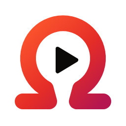

<p align="center">
  <picture>
    <source media="(prefers-color-scheme: dark)" srcset="branding/omegatube-mark-dark.png">
    
  </picture>
</p>

<h1 align="center">OmegaTube</h1>

<p align="center">
  An ad-free YouTube client for Samsung smart TVs (Tizen) with SponsorBlock built in<br>
  and a <b>native video player</b> for smooth 4K playback.
</p>

---

## Contents

- [Features](#features)
- [Why OmegaTube?](#why-omegatube)
- [How it works](#how-it-works)
- [Install it on your TV (step by step)](#install-it-on-your-tv-step-by-step)
- [Troubleshooting](#troubleshooting)
- [Development](#development)
- [Credits and license](#credits-and-license)

## Features

- **No ads.** The app streams the video files directly, so there are no ads to show.
- **SponsorBlock**: skips sponsors, intros, reminders to subscribe and more, one setting per category (auto skip, skip button or off).
- **Native playback**: up to **4K / 1440p (VP9)** and 1080p60 (H.264), with a choice of codec. AV1 is experimental.
- **Your Google account**: sign in with a QR code. You get your home feed, subscriptions, history, likes and subscriptions, and your watch progress is kept in sync with your other devices.
- **Live streams, playlists and mixes**, with a "play next" countdown.
- **Subtitles**: auto-translated captions, adjustable size and background.
- **Audio tracks** for multi-language videos, playback speed and loop.
- **Dislike counts**, from [Return YouTube Dislike](https://returnyoutubedislike.com).
- **A remote-friendly interface** that follows SmartTube's layout, with a customisable side menu.
- **Languages**: English, French, Spanish.

## Why OmegaTube?

On Android TV, [SmartTube](https://github.com/yuliskov/SmartTube) is the reference for watching YouTube without ads. **Samsung TVs don't run Android but Tizen**, and SmartTube doesn't exist for Tizen.

The best Tizen option so far is [TizenTube](https://github.com/reisxd/TizenTube), loaded through TizenBrew. It runs YouTube's own TV web app and patches it to remove ads and add SponsorBlock. It works, but I kept hitting playback bugs:
stuttering video, audio dropouts, and audible "thumps" when the audio buffer runs dry.

Those bugs can't be fixed from TizenTube. A web app plays video through the **TV's built-in browser engine** (HTML5 `<video>` + Media Source Extensions). On these TVs that engine is old and closed, and the JavaScript has no control over how it buffers and decodes. A smooth player had to bypass the browser entirely.

OmegaTube is a ground-up rewrite. It does not use YouTube's web app or the browser's player. It downloads the streams itself and feeds the audio and video data straight to the TV's hardware decoders through Samsung's native player API, so buffering stays under the app's control. Playback is as smooth as the TV's own apps.

## How it works

```
┌──────────────────────────────────────────────────────────────┐
│  OmegaTube.tpk                                               │
│                                                              │
│  ┌────────────────────────────┐   P/Invoke   ┌─────────────┐ │
│  │ C# shell (TizenFX / NUI)   │ ───────────▶ │ C++ core    │ │
│  │  screens, remote control,  │   C API      │ libomega-   │ │
│  │  settings, translations    │ ◀─────────── │ core.so     │ │
│  └────────────────────────────┘   JSON       └──────┬──────┘ │
└─────────────────────────────────────────────────────┼────────┘
                       ┌──────────────────────────────┼─────────────────────┐
                       ▼                              ▼                     ▼
              YouTube (InnerTube API,       Samsung ESPlayer         SponsorBlock,
              video/audio streams, TLS)    (libesplusplayer.so,      Return YouTube
                                            hardware decoders)        Dislike
```

### The two halves

| Part | Language | Role |
| --- | --- | --- |
| `app/OmegaTube` | C# (.NET, TizenFX API 8, NUI) | The interface: screens, focus and remote control handling, settings, translations, local data (history, settings). It packages everything into a `.tpk`. |
| `core` | C++17 | Everything else: HTTPS, YouTube's API, sign-in, the MP4/WebM demuxers, the player that drives the hardware decoders, SponsorBlock. It is built as `libomegacore.so` and exposes a small C API (`core/include/omega/core.h`). |

### Why this split?

- **Why not a web app?** The browser's video player is where the bugs come from (see above).
- **Why not a pure native C/C++ app?** Samsung only lets third parties install native apps signed with a *partner* certificate. A .NET app, signed with the free developer certificate, may ship and load its own native `.so` library. So the C# part is a thin shell and the heavy lifting happens in C++.
- **Why C++ for the core?** It talks to Samsung's native `esplusplayer` C API (loaded with `dlopen` from the TV's firmware), parses video containers byte by byte and keeps memory under tight control. The same code also builds on a PC (`core/tools`), so YouTube and demuxer changes can be tested without a TV.

### Inside the core

| Module | What it does |
| --- | --- |
| `net/` | HTTPS client on [Mbed TLS](https://github.com/Mbed-TLS/mbedtls) with an embedded CA bundle. It does ranged reads with retries for videos and fetches segments for live streams. |
| `media/` | Demuxers for fragmented MP4 (H.264, AV1, AAC) and WebM (VP9, Opus) that split streams into packets for the decoder. |
| `player/` | Feeds the packets to the hardware through ESPlayer. Handles seeking, quality switching, A/V sync and a bounded buffer. |
| `yt/` | YouTube's internal *InnerTube* API: feeds, search, video details, captions, likes and subscriptions, watch history pings. Also Google sign-in (TV device flow), SponsorBlock, and a JavaScript solver ([QuickJS-ng](https://github.com/quickjs-ng/quickjs) + [yt-dlp EJS](https://github.com/yt-dlp/ejs)) for the fallback client's stream URLs. |
| `util/` | Logging and remote configuration. |

### Other design choices

- **Remote configuration (`remote-config.json`).** YouTube changes its private API often. The client names, versions and keys the app sends live in this file, not in the code. The app downloads the latest copy from this repository at startup (falling back to the copy built into it), so a YouTube change can often be fixed by editing one JSON file, without a new release.
- **Direct stream URLs.** The main client returns stream URLs that play directly, so nothing has to run YouTube's JavaScript. If it fails, a fallback TV client is used and its URLs are deciphered with the embedded JavaScript engine.
- **Pinned to Tizen 6.0 (API 8).** It is the oldest target the app supports. Newer TVs run older apps fine; the reverse is not true.
- **Reproducible cross-compiling.** The C++ core is built in a Docker image (`toolchain/Dockerfile`, Debian buster, `arm-linux-gnueabi`). Its C library (glibc 2.28) is older than the TV's (2.30), so the binary runs on the TV whatever your own Linux distribution is.

## Install it on your TV (step by step)

You don't need any technical knowledge: you copy one line, then the installer tells you what to do. It takes about 10 minutes the first time.

> **Which TVs?** Samsung smart TVs running **Tizen 6.0 or newer** (most models from **2021 onwards**). OmegaTube is developed on a 2021 AU series TV. Other models should work but are less tested. Feedback is welcome in the [issues](https://github.com/IIyn/omegatube/issues).

> **Why can't I just download it from the Samsung store?** Samsung's store does not accept apps like this one. Apps from outside the store must be **signed with a certificate made for your specific TV**, which needs a free Samsung account. The installer does all of this for you.

**You need:**

- your Samsung TV and its remote,
- a computer running **Windows 10/11**, **macOS** or **Linux**, on the **same network** as the TV (same Wi-Fi or box),
- a **Samsung account** (free, you can create one during the installation).

### 1. Open a terminal

- **Windows**: right-click the Start button and choose *Terminal* (or *Windows PowerShell*).
- **macOS**: open the *Terminal* app (press <kbd>Cmd</kbd> + <kbd>Space</kbd>, type `Terminal`, press Enter).
- **Linux**: open the *Terminal* app from your applications menu.

### 2. Paste this line and press Enter

**Windows:**

```powershell
irm https://raw.githubusercontent.com/IIyn/omegatube/main/scripts/install-tv.ps1 | iex
```

**macOS and Linux:**

```sh
curl -fsSL https://github.com/IIyn/omegatube/releases/latest/download/install.sh | bash
```

### 3. Follow the instructions

The installer does everything else and tells you when it needs you:

1. It downloads the tools it needs (Java and Samsung's TV tools, the first time only, a few minutes).
2. It shows **your computer's address** and asks you to turn on **Developer Mode** on the TV:
   - on the TV, open the **Apps** screen;
   - on the remote, type **1 2 3 4 5** (no number keys? press the **123** button to show a number pad on screen);
   - switch *Developer Mode* **On**, enter the computer's address in **Host PC IP** and confirm;
   - **restart the TV**: hold the remote's power button until the Samsung logo appears again.
3. It asks for **the TV's address**. You can find it on the TV in **Settings → General → Network → Network Status → IP Settings** (for example `192.168.1.9`).
4. It **opens a Samsung sign-in page in your browser**: sign in (or create an account). This creates the certificate for *your* TV. You only do this once.
5. It downloads the latest OmegaTube, signs it for your TV, installs it and opens it.

When you see **"Done!"**, OmegaTube is in your TV's app list. In the app, open **Account** to sign in to YouTube by scanning the QR code with your phone.

### Updating

Run the same line again. Your certificate is reused, so there's no Samsung sign-in this time, and your settings and YouTube account are kept. If Developer Mode is still on with your computer's address, just press Enter at that step.

### Where things go

The installer only writes in these folders, which you can delete once OmegaTube is installed (keep the certificate if you want updates to keep your settings):

| | Samsung's TV tools | Java, downloads, certificate |
| --- | --- | --- |
| Windows | `C:\tizen-studio` | `C:\omegatube-installer` (certificate in `certificate\`) |
| macOS / Linux | `~/tizen-studio` | `~/.omegatube-installer`, certificate in `~/SamsungCertificate/omegatube` |

### Without the one-liner

You can also download `install.ps1` (Windows) or `install.sh` (macOS, Linux) from the [latest release](https://github.com/IIyn/omegatube/releases/latest) and run it, optionally with the TV address to skip the questions: `bash install.sh 192.168.1.9`, or in PowerShell `powershell -ExecutionPolicy Bypass -File install.ps1 192.168.1.9`.

## Troubleshooting

| Problem | Solution |
| --- | --- |
| *"The TV did not answer"* | Check that Developer Mode is **On** with **your computer's** address, that the TV was **fully restarted** afterwards, and that both devices are on the same network. A VPN on the computer can also block the connection. |
| Windows asks whether to allow *sdb* or *Java* through the firewall | Allow it on private networks: it's how the computer talks to the TV and receives the Samsung sign-in. |
| A Mac with an Apple chip asks to install *Rosetta* | Accept: Samsung's TV tools are built for Intel Macs and need it. |
| The browser page doesn't open | Copy the link printed in the terminal into your browser. |
| Install fails with a *signature* or *certificate* error | An older OmegaTube signed with another certificate is installed. Uninstall it on the TV (Apps → OmegaTube → long-press OK → Delete) and run the installer again. |
| The app disappeared after a few days | This shouldn't happen with Developer Mode on. Run the installer again. |
| Another tool (e.g. TizenBrew) needs a different *Host PC IP* | You can change it back after installing. OmegaTube keeps working; the address only matters while installing. |
| Your Samsung certificate expired (after one year) | Run the installer again to create a new one. If the install is refused, uninstall OmegaTube first (you will have to sign in to YouTube again). |
| A video won't play / YouTube changed something | Open an [issue](https://github.com/IIyn/omegatube/issues) with the video link. Many fixes arrive through `remote-config.json` and need no reinstall. |

## Development

### Requirements

- **Linux** (macOS should work for most steps but isn't tested)
- **Docker**: cross-compiles the C++ core
- **.NET SDK 10**: builds the C# app (the Tizen SDK comes from NuGet)
- **Tizen Studio CLI 6.1** with the **Samsung Certificate Extension** (`cert-add-on`): signs and installs packages. The end-user installer (`scripts/install-tv.sh`) sets it up into `~/tizen-studio`, or do it by hand:
  ```sh
  bash web-cli_Tizen_Studio_6.1_ubuntu-64.bin --accept-license ~/tizen-studio
  ~/tizen-studio/package-manager/package-manager-cli.bin install --accept-license cert-add-on
  ```
- **Java 11+** (17 recommended), `curl`, `unzip`, `python3`
- A Samsung TV in Developer Mode pointing to your PC (see [step 2](#step-2-turn-on-developer-mode-on-the-tv))

### First build

```sh
scripts/fetch-deps.sh                       # third-party sources -> build/deps (pinned versions)
scripts/gen-cert.sh <TV DUID> "Your name"   # Samsung certificate + "omegatube" signing profile, once
scripts/build-app.sh                        # core (Docker) + C# app -> signed .tpk
TV_IP=192.168.1.9 scripts/deploy.sh         # install + launch on the TV
```

To get the TV's DUID: `~/tizen-studio/tools/sdb connect <TV IP>:26101 && ~/tizen-studio/tools/sdb shell 0 getduid`.

### Logs from the TV

Retail TVs don't give a usable shell, so the core can mirror its log over UDP to your PC:

```sh
OMEGA_DEV_LOG=192.168.1.17:5555 scripts/build-app.sh   # your PC's address; writes res/dev.json (git-ignored)
scripts/serve-test-media.sh                            # prints the TV's log lines (UDP 5555)
```

Never publish a build made with `OMEGA_DEV_LOG`. A plain `scripts/build-app.sh` removes it.

### Testing on the PC

The core builds natively as well, with tools that run the same code as the TV:

```sh
cmake -S core -B build/host -DOMEGA_HOST_TOOLS=ON && cmake --build build/host -j
build/host/ytcheck <videoId>               # resolve formats and download through the core's HTTP stack
build/host/ytcheck --signin                # device-flow sign-in, then home + subscriptions
build/host/ytcheck --search "query"        # also --captions, --details, --channel, --sb, --playlist...
build/host/mp4dump <file.mp4|webm> [ms]    # run the demuxers on a local file (optionally from a seek)
```

The full list of commands is at the top of `core/tools/ytcheck.cpp`. `tools/yt-probe/probe.py` checks which YouTube clients currently return playable streams. `tools/flaky-server/flaky.py` serves a file over a deliberately unreliable connection, to test recovery.

### Project layout

```
app/OmegaTube/        C# shell: OmegaTube.cs (app + navigation), Ui/ (screens), Data/ (YouTube bindings,
                      local store), Config/, I18n.cs (translations), NativeCore.cs (P/Invoke), res/
core/                 C++ core: include/omega/core.h (C API), src/{net,media,player,yt,util}, tools/
toolchain/            Docker cross toolchain for Tizen 6.0 (armv7, softfp)
scripts/              fetch-deps, build-core, build-app, deploy, gen-cert, install-tv, serve-test-media
tools/                samsung-cert (headless certificate generator), yt-probe, flaky-server
remote-config.json    YouTube client parameters, fetched by the app at startup
VERSION               the single version number (copied into the manifest and the core at build time)
```

### Translations

App texts are written in English in the code (`T("Settings")`). The French and Spanish tables are in `app/OmegaTube/I18n.cs`. To add a language, add a table there and its code to `I18n.Codes`.

### Releasing

1. Bump `VERSION`, commit, push.
2. Publish a GitHub release with the tag `v<VERSION>` (e.g. `v1.0.1`).
3. The [`Release build`](.github/workflows/release.yml) workflow builds the core and the app and attaches `OmegaTube.tpk`, `install.sh` and `install.ps1` (copies of `scripts/install-tv.sh` / `.ps1`) and `SamsungCert.java` to the release, under these fixed names. The installers download them from `releases/latest/download/`, so they always install the newest release. The Windows one-liner reads `scripts/install-tv.ps1` from `main` (served as text, which `irm | iex` needs), so keep it working on `main`.

The CI package keeps the SDK's test signature: every user signs it for their own TV during installation.

## Credits and license

OmegaTube is free software under the [GNU GPL v3](LICENSE).

It stands on the shoulders of [SmartTube](https://github.com/yuliskov/SmartTube) (interface and icons), [ytps5-sponsorblock](https://github.com/animatian112/ytps5-sponsorblock) (sign-in, InnerTube and watch history approach), [SponsorBlock](https://sponsor.ajay.app), [Return YouTube Dislike](https://returnyoutubedislike.com), [yt-dlp](https://github.com/yt-dlp/yt-dlp)'s EJS solver and other libraries. The full list and their licenses are in [THIRD_PARTY_NOTICES.md](THIRD_PARTY_NOTICES.md).

YouTube is a trademark of Google LLC. OmegaTube is an independent project, not affiliated with Google, YouTube or Samsung.
