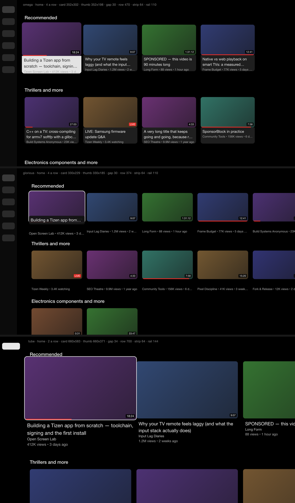

# UI preview and layout checks

The interface is C# on Tizen.NUI, which only runs on a TV (or the Tizen emulator, see
`scripts/emulator.sh`). Everything else in this repo can be exercised on a PC — `ytcheck` runs the core, the
tests run the parsers — but a layout change could only be judged by building a `.tpk`, installing it on a TV
and taking a photo. This tool closes that gap: it rebuilds each interface style's layout **from the numbers in
the C# sources** and renders it at 1920x1080, then checks the geometry.



## Running it

```sh
python3 tools/ui-preview/preview.py                      # every style: PNGs + checks
python3 tools/ui-preview/preview.py --styles tube         # one style
python3 tools/ui-preview/preview.py --no-shot             # numbers only, no browser
python3 tools/ui-preview/preview.py --seed my-feed.json   # another seeded feed (same schema as seed.json)
python3 tools/ui-preview/preview.py --screen 1280x720     # lay out at another logical size
```

Output lands in `tools/ui-preview/out/` (git-ignored) as `<style>-<view>.png` plus the same page as `.html`.
Views are `home`, `grid` and `player`. It exits non-zero when a geometry check fails.

Screenshots come from headless Chrome, so there is no extra dependency; on a machine without Chrome it writes
the `.html` instead and says so.

## What it draws

`seed.json` is the feed: twelve videos with the shapes that break layouts — a 151-character title, a live
item, watched progress, short and long durations. Each view is drawn from the constants the app uses:

| Parsed from | Gives |
|---|---|
| `Ui/Theme.cs` | card sizes, gaps, row pitches, rail widths, type sizes, the Tube geometry |
| `Ui/Card.cs` | the info block, insets, the rounded mask |
| `Ui/FeedGrid.cs` | columns, gaps, the grid's card width |
| `Ui/FeedRow.cs` | `StripY`: a row's heading sits at 0 and its cards start here |
| `Ui/PlayerScreen.cs` | the chrome lift, the revealed suggestions row, the description below it |

Nothing is duplicated here: the constants are read out of the sources, so the preview cannot drift from the
code it previews. A style whose constants are missing is reported as skipped rather than guessed.

## What it checks

Geometry fails the run; the text figures are reported as `WARN` because a long title being ellipsised is the
interface behaving, not a bug — they are what to compare between styles.

- the style's card count a row, and that the next card peeks in where that look intends it to
- thumbnails really are 16:9
- the row pitch clears the card, the focused card, and heading + cards (`StripY + card + 16`)
- the cards end inside the screen once the rail and the row's inset are counted
- the text block fits the space the look reserves under the thumbnail
- **the card's alpha mask covers the still the core requests** (`round_mask_hd` 1280x720): `CropToMask` crops
  to the mask's pixel rectangle, so a smaller mask zooms every thumbnail
- the player's revealed state: the video title and progress bar stay on screen, the suggestions row ends above
  the screen bottom, the description starts below it, cards fit their row, and the row is independent of the
  home pitch

## What it caught

Three bugs reached a TV before this existed; each is now a check that fails on the old numbers:

1. **A row's heading landed on the row above.** A row draws its heading at y=0 and its cards from
   `StripY=64`, so a 443px card needs a 507px row; the Tube style had 500. Now `pitch >= StripY + card + 16`.
2. **Every thumbnail was zoomed ~3x.** `Widgets.MaskedImage` sets `CropToMask`, which crops the image to the
   mask's pixel rectangle: a 400x225 mask over YouTube's 1280x720 still showed its top-left corner scaled to
   the card. Invisible while the core asked for a 320x180 file, because there the crop clamps to the whole
   image — the sharper source exposed it. Now the mask is checked against the still.
3. **The player slid its own controls off screen.** The chrome lift had been derived from the home row pitch,
   so the Tube style's 700px row lifted the chrome 770px: the video title went to y=-180 and the suggestions
   row ended at 1270 on a 1080 screen. Now the revealed state is checked directly.

The lesson each time was the same: the preview is only worth having if it models the thing that broke. Two of
the three were found *because* the model was extended to draw row headings and the player, which is why the
`player` view exists at all.

## Screen sizes

The interface is laid out at 1920x1080 — `Theme.DesignWidth/Height`, and the reason for the ~100 hardcoded
1920/1080 values across the UI. `Screen.FitToWindow` scales the finished page into the window it is given (the
smaller of the two ratios, so nothing is cropped), so one layout lands unchanged on a 720p, 1080p or 1440p
logical surface. `--screen WxH` renders the page scaled into that window, which is what a device of that size
would show:

```sh
python3 tools/ui-preview/preview.py --screen 1280x720   # the 1920x1080 page at scale 0.667
```

The checks always run against the 1920x1080 design, because that is the space every style is specified in.

## Limits

This is not NUI. Text metrics are an approximation (`LINE = 1.45`, measured on a TV: two lines of a 30px
label need more than 80px, and 1.28 was wrong), the preview's fonts are not the TV's, and thumbnails are
colour placeholders. It answers *where things are* and *whether they fit* — not how a still is rasterised, how
a mask looks against real artwork, or how focus feels on the panel. Those still need the TV.

## Related

`tools/round-mask/make_mask.py` renders the cards' rounded alpha masks (`round_mask`, and `round_mask_hd` at
the size of the still the core requests). Regenerate with:

```sh
python3 tools/round-mask/make_mask.py
```
